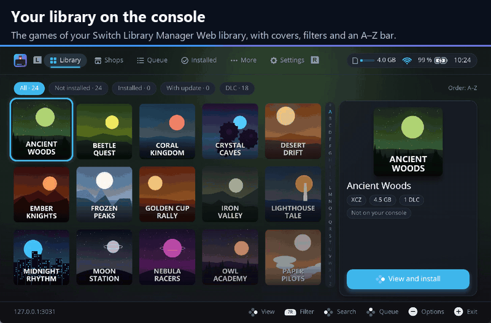
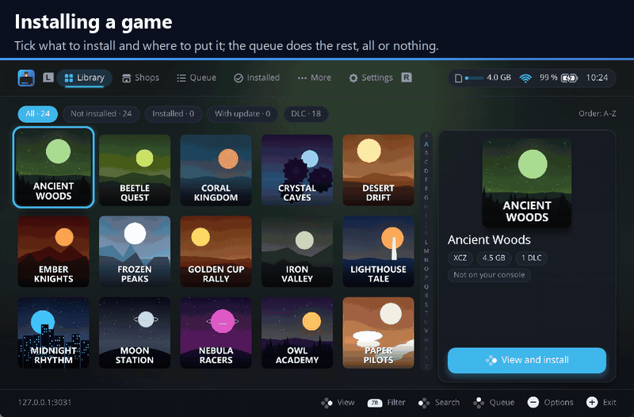
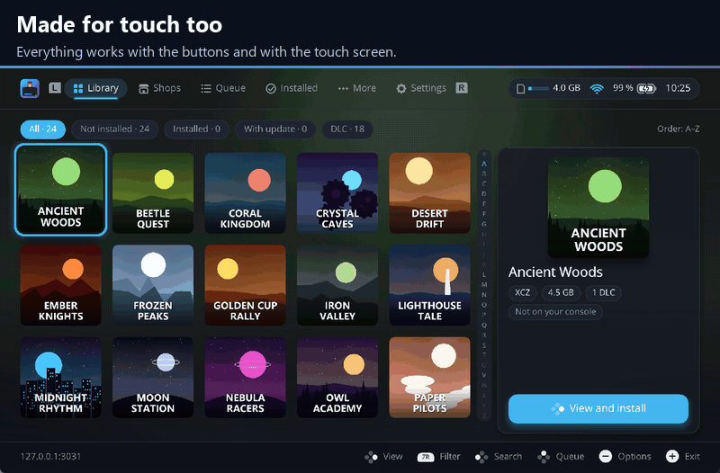
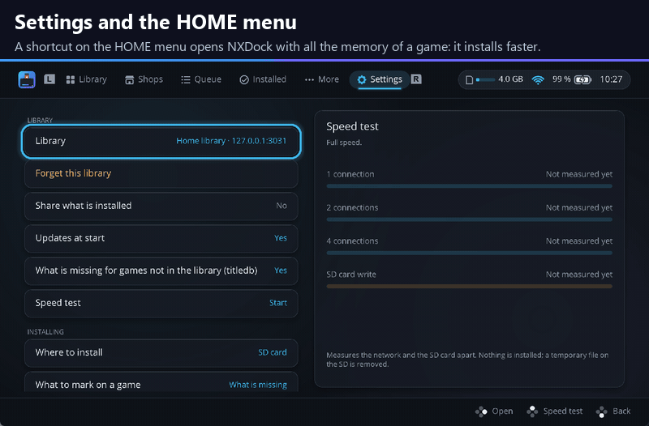

<p align="center"></p>

# NXDock

[](https://ko-fi.com/delfus77)
[](https://discord.gg/acQVZSEBR)
[](https://github.com/DeLFuS77/NXDock/releases)
[](https://github.com/DeLFuS77/NXDock/releases)
[](https://github.com/DeLFuS77/NXDock/actions/workflows/build.yml)
[](https://github.com/DeLFuS77/NXDock/blob/main/LICENSE)


A homebrew installer for the Nintendo Switch, **in beta**. It installs your own NSP, NSZ, XCI and XCZ copies from your
[Switch Library Manager Web](https://github.com/DeLFuS77/switch-library-manager-web) library over the network, with
no files copied to the SD card first. It also installs from the SD card, a USB disk, or a computer over MTP or
NS-USBloader, and works with the buttons and with the touch screen alike.

> [!WARNING]
> **NXDock is a beta.** It has not been tested in depth yet, so it may still have bugs and errors. It needs more
> people to try it, so any problem you find helps a lot: please
> [report it](https://github.com/DeLFuS77/NXDock/issues/new/choose) or tell on [Discord](https://discord.gg/acQVZSEBR),
> however small. Sorry in advance for any trouble it may cause. NXDock is provided as it is, without any warranty, and its authors are not responsible for any problem or
> loss that comes from using it (see the [GPL-3.0](LICENSE)). Keep copies of what matters to you.

💬 Questions, ideas or news of new versions? Join the [Discord server](https://discord.gg/acQVZSEBR), shared with
[Switch Library Manager Web](https://github.com/DeLFuS77/switch-library-manager-web) and
[NXPress](https://github.com/DeLFuS77/NXPress).

<p align="center">
  <a href="https://ko-fi.com/delfus77"></a>
  <br>
  <sub>❤️ Free and open source, and it will stay free. If it saves you time, a coffee helps keep it going.</sub>
</p>



## NXDock and other installers

DBI, Sphaira, Tinfoil and others are mature and do a lot. NXDock is new, and does some things of its own:

- **Your library, straight from the computer or NAS.** NXDock finds Switch Library Manager Web on your network and
  pairs with a code: no addresses, no keys and no files to copy first. A game can also be sent to the console from
  the web.
- **The compressed files of NXPress.** NSZ and XCZ made with the extra compression of
  [NXPress](https://github.com/DeLFuS77/NXPress) install as they are; other installers do not read them yet.
- **Installs you can trust.** All or nothing: every part is checked against its SHA-256 before anything is
  registered, a failed or cancelled install leaves nothing behind, an install cut by the console going off goes on
  where it stopped, and only the parts the console does not already have are downloaded. **Check** and **Repair**
  find and fix a damaged installed game.
- **Your saves first.** Before an update, a repair or going back to another version, the save of the game is copied
  to your library.
- **Smaller games on the console (experimental).** Installed games can be compressed, and a game merged with its
  update.
- **An interface made for the console.** Covers, colours that follow the game in focus, a queue with every stage of
  an install, touch everywhere and 11 languages.

If you need something NXDock does not have yet, such as FTP or WebDAV sources, NTFS disks or editors for files, DBI and
Sphaira are great choices, and they work side by side with NXDock.

## Features



- **A page for each game.** Its cover, version, format, size and the firmware it needs, with the game, its newest
  update and every DLC to tick (what is missing comes ticked), and the space left after. The SD card is always the
  default; the internal memory is used only for the install where you choose it.
- **Fast installs.** Each file comes over several connections at once, as many as the speed test found best; NSZ and
  XCZ travel compressed and are decompressed on three threads while the next blocks download.
- **A queue you can watch.** The game being installed, large, with its four stages: network, decompress, write and
  check. The queue goes on while you browse, and the library app can follow it, pause it or cancel it.
- **Keep it tidy.** Update all, Check and Repair, another version of an update, undo what this session installed, a
  history of every install, and **what is missing** for every game on the console, also those not in your library.
- **Clear errors.** A failed install says what happened and what to do, with a code to look up.
- **Updates itself** from its releases, after checking their signature, and keeps the version before to go back to.


- **Install without the library app:** from the SD card or a USB disk (FAT32 or exFAT, split files included), from a
  computer over MTP or over the USB cable with NS-USBloader, or from shops of the kind of Tinfoil and Ownfoil.
- **Files:** copy, move, rename, make folders and delete on the SD card and a USB disk, with many files at once. The
  folders of the system are never touched.
- **MTP** also shows the installed games as NSP, the saves, the Album and a USB disk, read only.
- **Saves:** copy them to your library or to the SD card, by hand or every few days, and restore them later.
- **Space and dumps:** clean leftovers, archive games, move a game between the SD card and the internal memory, dump
  the game card or an installed game, and check the SD card for fakes and errors.
- **Cheats and mods:** the cheats your library has for the version on the console, and `.zip` mod packages, each
  with a switch.
- **Compress games (experimental):** see [Compress games](https://github.com/DeLFuS77/NXDock/wiki/Compress-games).





| The library | The page of a game |
|---|---|
| <picture><source media="(prefers-color-scheme: dark)" srcset="docs/screenshots/library-dark.png"></picture> | <picture><source media="(prefers-color-scheme: dark)" srcset="docs/screenshots/game-dark.png"></picture> |

It follows the light or dark theme of the console, or the one chosen, and speaks English, Spanish, French, German,
Italian, Portuguese, Dutch, Russian, Japanese, Korean and Chinese. A first-run wizard sets the language, the theme,
where to install and the notices.

The screenshots and animations were taken in an emulator, with made-up games and covers.

## Requirements

- A Nintendo Switch that runs homebrew, with [Atmosphère](https://github.com/Atmosphere-NX/Atmosphere). An emuMMC is
  recommended: NXDock warns before the first install when it is not on one, or when the console can reach
  Nintendo's servers.
- **Sigpatches:** NXDock installs without them, but most of your own copies need them to start, as with any
  installer. Compressed games always need them. NXDock never installs sigpatches nor firmware.
- **Firmware:** the one your Atmosphère supports. Each game says the firmware it needs, and NXDock warns before
  installing a game the console is too old for.
- To install from your library: [Switch Library Manager Web](https://github.com/DeLFuS77/switch-library-manager-web)
  2.0.5 or newer on a computer, a NAS or Docker in the same network, with **Install over the network** turned on in
  its Settings.
- For Compress games: firmware 12 or newer, and your `prod.keys` at `sdmc:/switch/prod.keys` (read only to compress,
  kept in memory, never shown or saved).
- Open NXDock with the full memory of a game: from its shortcut on the HOME menu (Settings › HOME menu), or by
  holding R while opening a game. From the Album it also works, more slowly, and says so.

For your own games and your own consoles only. NXDock includes no keys, games or firmware.

More: [Compatibility](https://github.com/DeLFuS77/NXDock/wiki/Compatibility).

## Installation

1. Download `NXDock-<version>-sd.zip` from the [releases page](https://github.com/DeLFuS77/NXDock/releases). While
   NXDock is a beta, its releases are marked as pre-releases.
2. Unpack it at the root of the SD card: it puts `switch/NXDock/NXDock.nro` in place. (Or copy `NXDock.nro` on its
   own to `sdmc:/switch/NXDock/`.)
3. Open it from the Homebrew Menu. In Settings › HOME menu you can add a shortcut to open it from the HOME menu.

NXDock tells when a new version is out and updates itself from Settings. Settings and the history stay in
`sdmc:/config/NXDock/` and `sdmc:/switch/NXDock/`.

## Pairing with the library app

NXDock finds the library app on your network by itself: no addresses and no keys to type.

1. Turn on **Install over the network** in the Settings of Switch Library Manager Web.
2. Open NXDock. It lists the library apps it found; choose yours.
3. NXDock shows a code of eight letters and a QR. Open the library app on your phone or computer (the QR opens it): a
   notice with the same code shows on any page. Check that it matches and press **Accept**.
4. With **Remember this library** ticked, the next times NXDock connects by itself, also when the address of the app
   changes.

An app outside your home network or behind a proxy can be typed by hand (Settings › Address by hand). With an
`https` address, NXDock keeps the key of its certificate the first time and refuses a server with another key
afterwards.

## Documentation

The [wiki](https://github.com/DeLFuS77/NXDock/wiki) explains each screen, Compress games, compatibility and the most
common questions:

- [Using NXDock](https://github.com/DeLFuS77/NXDock/wiki/Using-NXDock)
- [Compress games](https://github.com/DeLFuS77/NXDock/wiki/Compress-games)
- [Compatibility](https://github.com/DeLFuS77/NXDock/wiki/Compatibility)
- [Questions and problems](https://github.com/DeLFuS77/NXDock/wiki/FAQ)
- [Reporting a problem](https://github.com/DeLFuS77/NXDock/wiki/Reporting-a-problem): what to send and where the logs
  are

## Related projects

- [Switch Library Manager Web](https://github.com/DeLFuS77/switch-library-manager-web): your library of games,
  updates and DLC in the browser, on a computer, a NAS or Docker. NXDock installs from it.
- [NXPress](https://github.com/DeLFuS77/NXPress): compresses NSP and XCI to NSZ and XCZ, with an extra compression
  that NXDock installs as it is.

## Verifying the downloads

Each release has `SHA256SUMS.txt` with the checksums of its files, and `SHA256SUMS.txt.minisig`, their signature
with the key of the project, made on the maintainer's computer and never on GitHub:

```sh
minisign -Vm SHA256SUMS.txt -p release.pub
sha256sum -c SHA256SUMS.txt
```

`release.pub` is in this repository. `gh attestation verify <file> -R DeLFuS77/NXDock` also proves that a file was
built by this repository's workflow from the tagged source.

## Building

You need Docker. From the repository root:

```sh
tools/build.sh   # builds build/NXDock.nro in the official devkitpro/devkita64 container
tools/test.sh    # the tests that need no console
```

See [CONTRIBUTING.md](CONTRIBUTING.md) for how the code is laid out.

## Credits

NXDock's installer is built on **yati**, the install core of [Sphaira](https://github.com/NaGaa95/sphaira), by
ITotalJustice and the Sphaira contributors: thank you. The HOME menu shortcut also comes from Sphaira. NXDock also
uses [libnx](https://github.com/switchbrew/libnx), [deko3d](https://github.com/devkitPro/deko3d),
[nanovg for deko3d](https://github.com/ITotalJustice/nanovg-deko3d), [yyjson](https://github.com/ibireme/yyjson),
[libusbhsfs](https://github.com/DarkMatterCore/libusbhsfs), [Zstandard](https://github.com/facebook/zstd),
[Mbed TLS](https://github.com/Mbed-TLS/mbedtls), [libcurl](https://curl.se),
[Monocypher](https://monocypher.org), the [QR Code generator library](https://github.com/nayuki/QR-Code-generator)
and parts of [nxdumptool](https://github.com/DarkMatterCore/nxdumptool). [NOTICE](NOTICE) lists each one with its
licence and what was changed.

## License

GPL-3.0-or-later. See [LICENSE](LICENSE) and [NOTICE](NOTICE).
