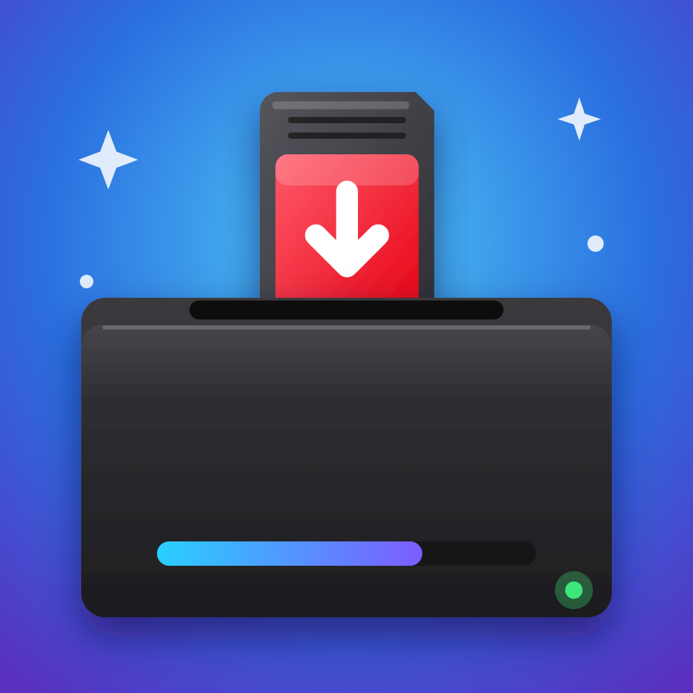
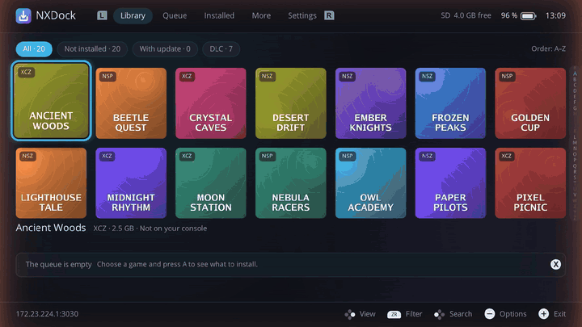
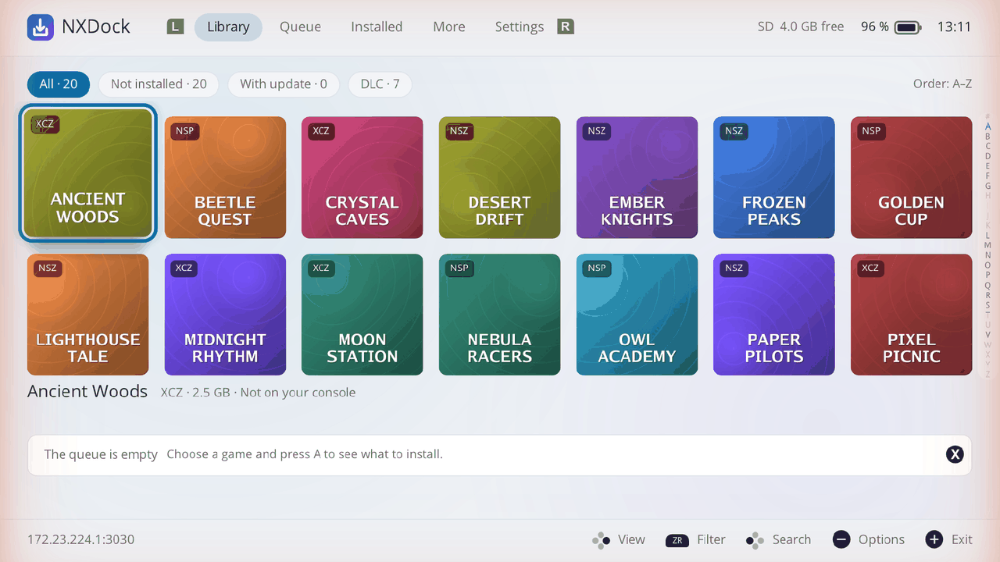
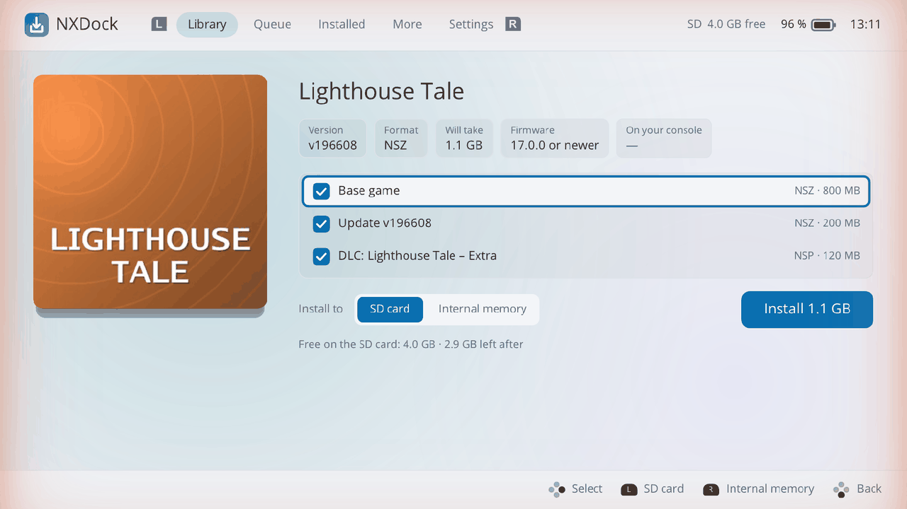
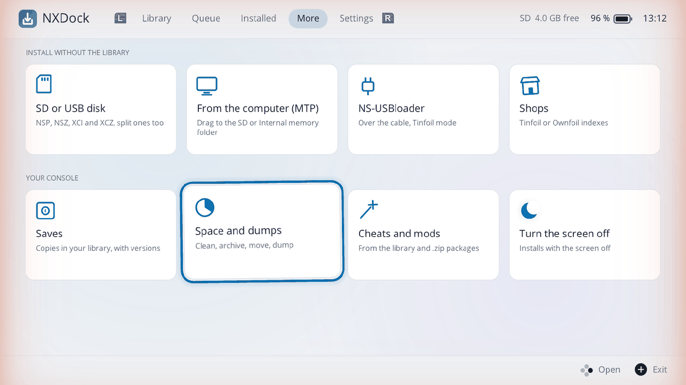
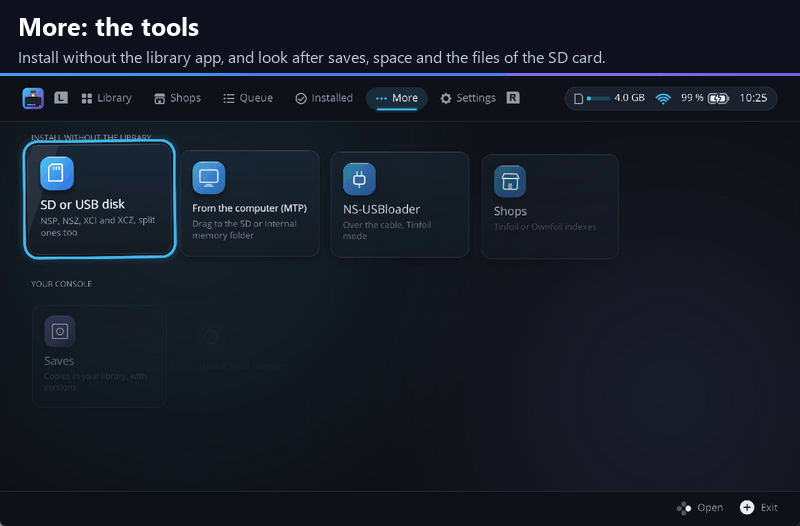
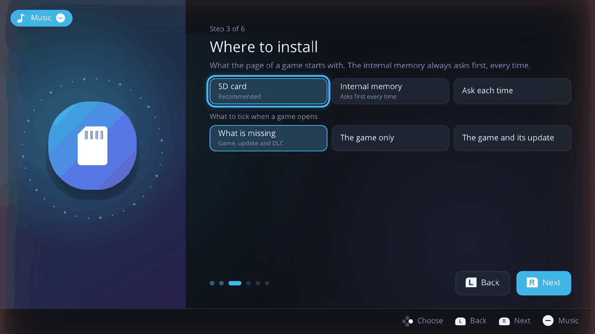
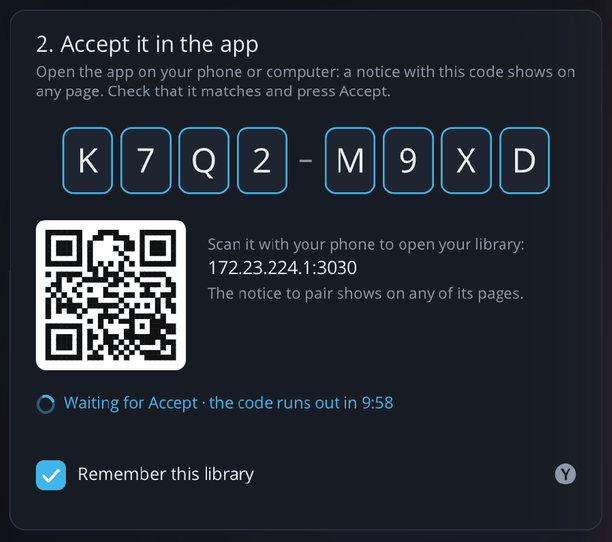

<p align="center"></p>

# NXDock

[](https://ko-fi.com/delfus77)
[](https://discord.gg/acQVZSEBR)
[](https://github.com/DeLFuS77/NXDock/releases)
[](https://github.com/DeLFuS77/NXDock/releases)
[](https://github.com/DeLFuS77/NXDock/actions/workflows/build.yml)
[](https://github.com/DeLFuS77/NXDock/blob/main/LICENSE)


A homebrew installer for the Nintendo Switch. It installs your own NSP, NSZ, XCI and XCZ copies from your
[Switch Library Manager Web](https://github.com/DeLFuS77/switch-library-manager-web) library over the network, with
no files copied to the SD card first. It can also install from the SD card, a USB disk, or a computer over MTP or
NS-USBloader.

> [!IMPORTANT]
> **NXDock is still being tested.** It needs more people to try it, so any problem you find helps a lot: please
> [report it](https://github.com/DeLFuS77/NXDock/issues/new/choose), however small. Sorry in advance for any trouble it
> may cause. NXDock is provided as it is, without any warranty, and its authors are not responsible for any problem or
> loss that comes from using it (see the [GPL-3.0](LICENSE)). Keep copies of what matters to you.

💬 Questions, ideas or news of new versions? Join the [Discord server](https://discord.gg/acQVZSEBR), shared with
[Switch Library Manager Web](https://github.com/DeLFuS77/switch-library-manager-web) and
[NXPress](https://github.com/DeLFuS77/NXPress).

<p align="center">
  <a href="https://ko-fi.com/delfus77"></a>
  <br>
  <sub>❤️ Free and open source, and it will stay free. If it saves you time, a coffee helps keep it going.</sub>
</p>

It has an interface of its own, made for the console: your library as a grid of covers, a page for each game, and a
queue that shows every stage of an install. It works with the buttons and with the touch screen alike.



## Features

<picture>
  <source media="(prefers-color-scheme: dark)" srcset="docs/screenshots/library-dark.png">
  
</picture>

- **Your library on the console.** The games of the library app with their covers, filters (all, not installed, with an
  update, with DLC) and search with the console's keyboard. What the console already has is read from the system, so
  each game tells what is missing. An A–Z bar, jumps by letter with the right stick and orders by name, size, newest
  or not installed first help in a long library.
- **A page for each game.** Its cover, version, format, size and the firmware it needs, with the game, its newest
  update and every DLC to tick (what is missing comes ticked), the SD card or the internal memory, and the space left
  after.
- **Fast installs.** Each file comes over several connections at once, as many as the speed test found best; NSZ and
  XCZ travel compressed and their blocks are decompressed on three threads while the next ones download. A dropped
  connection goes on from where it stopped.
- **Safe installs.** All or nothing: the free space and the firmware are checked first, every part is checked against
  its SHA-256 before anything is registered, and a failed or cancelled install leaves nothing behind. Parts the
  console already has are kept, so only what is missing comes. An install cut because the console went off goes on
  where it stopped. The SD card is the default; the internal memory is used only after a question. Installing never
  reads your `prod.keys`, and NXDock never installs firmware or sigpatches.
- **Your saves first.** Before an update, a repair, a removal or going back to another version, the save of the game
  is copied to your library. Before an update, NXDock also says which of your cheats and mods stop working with the
  new build.
- **The extra compression of NXPress.** NSZ and XCZ made with the extra compression of
  [NXPress](https://github.com/DeLFuS77/NXPress) (NCZSECT2 and NCZSECT3) install as they are.
- **A queue you can watch.** The game being installed, large, with its four stages: network, decompress, write and
  check. The queue goes on while you browse the library. At the end, a notice, a soft sound and two gentle pulses of
  rumble; while it works, the screen can dim or turn off.
- **Keep it tidy.** "Update all" installs every newer update the library has for what is on the console. "Check"
  reads an installed game and compares every part with its SHA-256, and "Repair" downloads only the damaged parts.
  "Undo" removes what was installed in this session, and the history keeps every install with its time and speed.
- **Send to the console from the web.** A game sent from the library app shows on the console with who sent it, and
  nothing is installed until you accept. The queue can be followed live in the library app, paused or cancelled from
  there (the console asks first), and a message can reach your phone when it ends.
- **Another version.** The page of a game can put an older update in place of the installed one, all or nothing.
- **Clear errors.** A failed install says what happened and what to do, with a code to look up.

| The page of a game | More: the tools |
|---|---|
| <picture><source media="(prefers-color-scheme: dark)" srcset="docs/screenshots/game-dark.png"></picture> | <picture><source media="(prefers-color-scheme: dark)" srcset="docs/screenshots/more-dark.png"></picture> |

### More



- **Install without the library app:** from the SD card or a USB disk (FAT32 or exFAT, split files included), from a
  computer over MTP (a game installs as it arrives, nothing is kept on the card) or over the USB cable with
  NS-USBloader. Everything goes to the same queue, all or nothing.
- **Shops** of the kind of Tinfoil and Ownfoil open as another library.
- **Saves:** copy the save of a game to your library and restore it later, always after a question; the save it
  replaces is kept first.
- **Space and dumps:** clean leftovers (also unfinished installs of other tools, and updates and DLC whose game is
  gone), archive games (the icon stays on the HOME menu), move a game between the SD card and the internal memory,
  and dump the game card or an installed game to your library.
- **Check the SD card** (in Space and dumps): finds fake cards, parts of the card that fail, and its real speed,
  with a quick or a full check.
- **Compress games (experimental):** installed games take less room on the console. See below.
- **Cheats and mods:** the cheats your library has for the version on the console, and `.zip` mod packages, each with
  a switch. Removing a mod takes away only what it wrote.

It follows the light or dark theme of the console, or the one chosen, and speaks 11 languages: English, Spanish,
French, German, Italian, Portuguese, Dutch, Russian, Japanese, Korean and Chinese. A first-run wizard sets the
language, the theme, where to install and the notices, and ends with a short walk through the tabs.

<p align="center"></p>

## Compress games (experimental)

Off until you turn it on, in More › Space and dumps. NXDock measures each installed game from a sample of its data and
offers the ones that save 10 % or more:

- **A game on its own** is compressed in place with the LZ4 layer that Nintendo uses in some of its games.
- **A game with its update** is merged with it into one game and compressed: what the update no longer reads is left
  out, and what it reads more than once is kept once. A game and its update can take far less room this way.
- **Its DLC** are compressed in the same step.
- **A newer update** installed with NXDock over a merged game is merged by itself when it ends.
- **Undo** installs the original game, its update and its DLC again from your library.

A compressed game is no longer signed by Nintendo: it starts only with sigpatches, and official updates must not be
installed over a merged game. Read [Compress games](docs/compress-games.md) before turning it on.


## Requirements

- A Nintendo Switch that runs homebrew, with [Atmosphère](https://github.com/Atmosphere-NX/Atmosphere). An emuMMC is
  recommended; NXDock warns before the first install when it is not on one, or when the console can reach
  Nintendo's servers.
- To install from your library: [Switch Library Manager Web](https://github.com/DeLFuS77/switch-library-manager-web)
  on a computer, a NAS or Docker in the same network, with **Install over the network** turned on in its Settings.
- For Compress games: firmware 12 or newer, sigpatches, and your `prod.keys` at `sdmc:/switch/prod.keys` (read only
  to compress, kept in memory, never shown or saved).
- Open NXDock with the full memory of a game (hold R while opening a game, then choose NXDock), not from the album:
  it gets larger network buffers and installs faster. It also works from the album, more slowly, and says so.

For your own games and your own consoles only. NXDock includes no keys, games or firmware.

## Installation

1. Download `NXDock-<version>-sd.zip` from the [releases page](https://github.com/DeLFuS77/NXDock/releases/latest).
2. Unpack it at the root of the SD card: it puts `switch/NXDock/NXDock.nro` in place. (Or copy `NXDock.nro` on its
   own to `sdmc:/switch/NXDock/`.)
3. Open it from the Homebrew Menu.

To update, put the new `NXDock.nro` in place of the old one. Settings and the history stay in
`sdmc:/config/NXDock/` and `sdmc:/switch/NXDock/`.

## Pairing with the library app



NXDock finds the library app on your network by itself: no addresses and no keys to type.

1. Turn on **Install over the network** in the Settings of Switch Library Manager Web.
2. Open NXDock. It lists the library apps it found; choose yours.
3. NXDock shows a code of eight letters and a QR. Open the library app on your phone or computer (the QR opens it): a
   notice with the same code shows on any page. Check that it matches and press **Accept**.
4. With **Remember this library** ticked, the next times NXDock connects by itself, also when the address of the app
   changes.

An app outside your home network or behind a proxy can be typed by hand ("Type the address", or Settings › Address by
hand). With an `https` address, NXDock keeps the key of its certificate the first time and refuses a server with
another key afterwards. Settings › Forget this library pairs again from the start.

<br clear="right">

## Verifying the downloads

Each release has `SHA256SUMS.txt` with the checksums of its files, and `SHA256SUMS.txt.minisig`, their signature
with the key of the project, made on the maintainer's computer and never on GitHub:

```sh
minisign -Vm SHA256SUMS.txt -p release.pub
sha256sum -c SHA256SUMS.txt
```

`release.pub` is in this repository. `gh attestation verify <file> -R DeLFuS77/NXDock` also proves that a file was
built by this repository's workflow from the tagged source.

## Building

You need Docker. From the repository root:

```sh
tools/build.sh   # builds build/NXDock.nro in the official devkitpro/devkita64 container
tools/test.sh    # the tests that need no console
```

See [CONTRIBUTING.md](CONTRIBUTING.md) for how the code is laid out. Tested with DBI as a reference.

The screenshots show made-up games. The animation of Compress games is an illustration drawn for this page, also
with made-up games.

More: [the documentation](docs/README.md).

## Credits

NXDock's installer is built on **yati**, the install core of [Sphaira](https://github.com/NaGaa95/sphaira), by
ITotalJustice and the Sphaira contributors: thank you. It also uses [libnx](https://github.com/switchbrew/libnx),
[deko3d](https://github.com/devkitPro/deko3d), [nanovg for deko3d](https://github.com/ITotalJustice/nanovg-deko3d),
[yyjson](https://github.com/ibireme/yyjson), [libusbhsfs](https://github.com/DarkMatterCore/libusbhsfs),
[Zstandard](https://github.com/facebook/zstd), [Mbed TLS](https://github.com/Mbed-TLS/mbedtls), [libcurl](https://curl.se),
the [QR Code generator library](https://github.com/nayuki/QR-Code-generator) and parts of
[nxdumptool](https://github.com/DarkMatterCore/nxdumptool). [NOTICE](NOTICE) lists each one with its licence and
what was changed.

## License

GPL-3.0-or-later. See [LICENSE](LICENSE) and [NOTICE](NOTICE).
