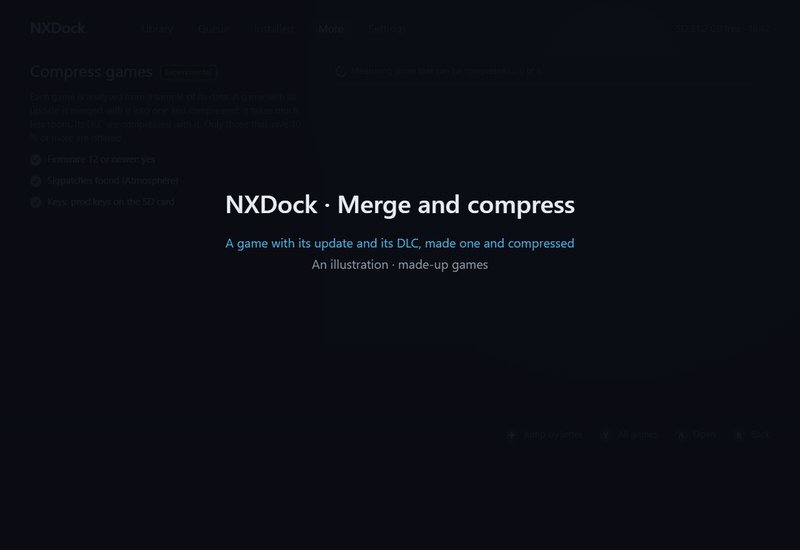

# Compress games (experimental)

Compress games makes installed games take less room on the console. It is in **More › Space and dumps › Compress
games**, and it stays off until you turn it on, after a window that says what it means.

*An illustration drawn for this page, with made-up games. The screen is the one NXDock shows.*

## What it does

NXDock reads each installed game from a sample of its data (one block in 32) and tells what it would save. Only the
games that save 10 % or more can be compressed. The list says what each game is:

| The row says | What it means |
|---|---|
| ~51 % · saves 192 MB | A game on its own, worth compressing. |
| Merge and compress · saves 4.8 GB | A game with its update installed: the two become one game, compressed. What it saves counts both. |
| + 2 DLC | Its DLC that are worth it are compressed in the same step. |
| Not worth it · 4 % | It would save less than 10 %: it stays as it is. |
| Already compressed by Nintendo | Nintendo compressed it as much as LZ4 allows: it stays as it is. |
| Compressed · saved … / Merged · saved … | NXDock compressed it. A opens Undo. |
| Merge the update (orange) | A newer update was installed over a merged game, from the eShop for instance. A merges it. |
| Undo it and merge it again (orange) | A newer update over a game that was merged when Nintendo had compressed it. See below. |

Y shows every game, also those that cannot be compressed, with the reason.

### A game on its own

The data of the game (its RomFS) is compressed in place with the LZ4 layer of the NCA, the same one Nintendo uses in
some of its games, at the level 9 of Nintendo's LZ4 HC, on three cores. The hashes of the game are made again as
Nintendo lays them out. The game is written into a new copy, checked, registered, and only then does the original go.
A game Nintendo compressed with its fast level is compressed again.

### A game with its update: merge and compress

An update reads its game by the places of its bytes, so the game alone cannot be written again. Instead, NXDock
reads the game and its update together, as the console reads them, and writes one game of the version of the update:

- what the update no longer reads of the game is left out;
- what it reads more than once is kept once, and so is any block equal to another;
- each block keeps the smaller of Nintendo's compression and NXDock's, so a game never grows;
- every block is checked against the hashes of the update while it is read.

Then the console itself reads the whole new game. Only if that works are the old game and the update removed. If
anything fails, the console is put back as it was.

The new game asks for no update and needs firmware 12 or newer.

### Its DLC

The DLC of a game that save 10 % or more are compressed right after the game, in the same step, in the same way as a
game on its own. A DLC that fails stays as it was; the game is already done.

### A newer update

- **Installed with NXDock:** when the install ends, NXDock merges it with the game by itself, in the same job of the
  queue.
- **Installed in another way** (the eShop, another installer): Compress games shows the game in orange, and a notice
  says so once. A merges it.

A merged game keeps a small "recipe" (a few KB) of where each piece of the original it read now lies. A newer update
usually reads almost the same pieces. What it reads that the merged game does not hold is usually a few MB; it comes
from what was kept beside the game when that was little, or is asked of your library app over the network. If neither
has it, nothing is changed and NXDock says that the base game is needed in the library.

**A game that Nintendo had compressed** keeps no recipe: its update read the compressed bytes of the original, which
the merged game does not hold. A newer update cannot be merged over it. Compress games shows it as "Undo it and merge
it again": Undo installs the original game and the newest update from your library, and then they can be merged again.

### Undo

A on a compressed or merged game opens Undo. The original game, its update and the DLC that were compressed are
installed again from your library app, in place of the compressed ones. The save is not touched. The library app must
have them.

## Before you turn it on

- **Sigpatches are needed.** A compressed game is no longer signed by Nintendo, and the console starts it only with
  the patches of its file system. NXDock looks for them (Atmosphère's `fs_patches`, sys-patch, or Hekate's
  `patches.ini`) and compresses nothing without them. NXDock never installs them.
- **Your `prod.keys`** at `sdmc:/switch/prod.keys` (Lockpick_RCM writes it there). They are needed to open the key of a
  game's ticket. They are read only to compress, kept in memory, never shown or saved.
- **Firmware 12 or newer**, the first that reads the LZ4 layer.
- **No official updates over a merged game.** The eShop will offer them; do not accept them. Install updates with
  NXDock, which merges them.
- **Check and Verify** see a compressed game as "Modified".
- **More risk if the console connects to Nintendo:** use an emuMMC and 90DNS.
- It takes a few minutes per game, and the console stays awake.

## What each game saves

Games with a lot of audio or video already compressed save little with LZ4; others save a lot. Some measures made on
the computer with the same code (a game and its update installed as NSP, against the merged game):

| Kind of game | Before | After | Saved |
|---|---|---|---|
| An indie game whose update replaced most of it | 5.7 GB | 0.9 GB | 84 % |
| A large racing game, many updates | 12.1 GB | 10.2 GB | 16 % |
| A fighting game with sparse storage | 5.1 GB | 4.8 GB | 7 % |
| A small game on its own | 377 MB | 186 MB | 51 % |

## Files

- `sdmc:/switch/NXDock/compressed.txt`: the games and DLC NXDock compressed. A mark goes by itself when the game is
  installed again.
- `sdmc:/switch/NXDock/recipes/`: the recipe of each merged game, what was kept of its original, and a mark that it
  was merged.
- `sdmc:/switch/NXDock/compress.log`: what Compress games found and did, step by step. Attach it to a bug report.

## Status

Compress games is checked on the computer: the games it writes are read back whole against their own hashes. It is
experimental: keep your library app with the originals, so Undo can always bring them back, and
[report](https://github.com/DeLFuS77/NXDock/issues/new/choose) anything that goes wrong, with `compress.log`.
